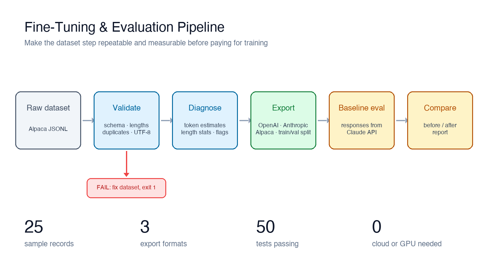
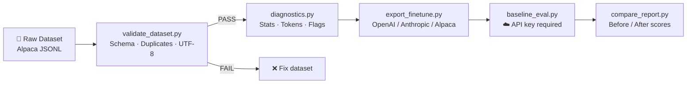
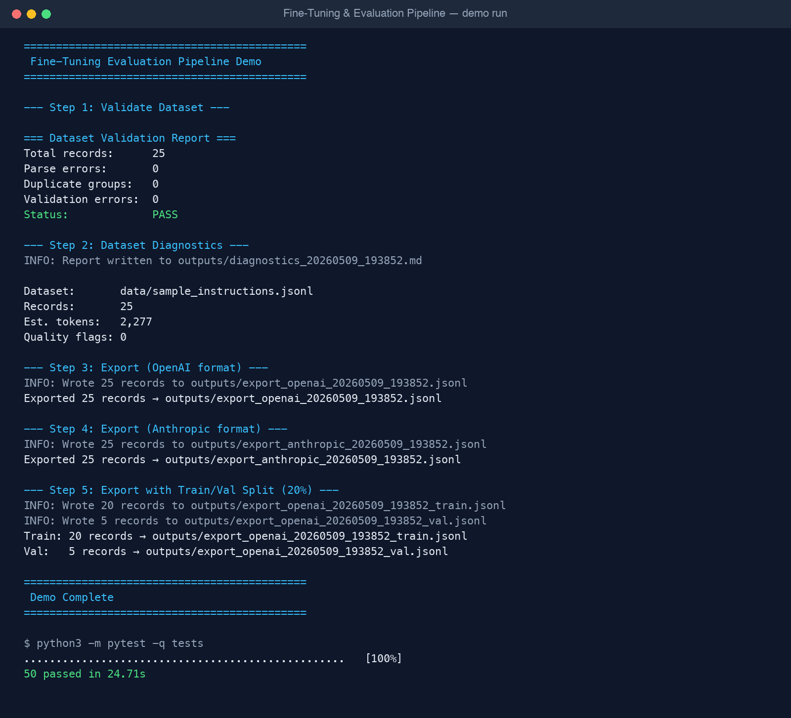

# Fine-Tuning & Evaluation Pipeline

Dataset preparation, quality validation, fine-tuning-ready exports, and before/after
evaluation comparison — all local-first, no cloud dependencies required.



## Pipeline Overview



> Full architecture diagrams: [`docs/architecture.md`](docs/architecture.md)

---

## What this does / does not do

**Does:**
- Validate JSONL dataset structure (schema, field lengths, duplicates)
- Generate diagnostics (token estimates, length stats, quality flags)
- Export datasets to OpenAI / Anthropic / Alpaca fine-tuning formats
- Run a baseline eval and compare before/after responses (requires API key)

**Does NOT:**
- Train or fine-tune any model
- Host or serve any model
- Require cloud credentials or GPU hardware

## Requirements

- **Python 3.10+**
- Dependencies: `anthropic`, `pytest` (see `requirements.txt`)

## Quickstart

Install dependencies and run the full pipeline in five commands:

```bash
# 1. Install
pip install -r requirements.txt

# 2. Validate — check schema, field lengths, duplicates
python scripts/validate_dataset.py data/sample_instructions.jsonl

# 3. Diagnose — token estimates, length stats, quality flags
python scripts/diagnostics.py data/sample_instructions.jsonl

# 4. Export — OpenAI or Anthropic fine-tuning format
python scripts/export_finetune.py data/sample_instructions.jsonl --format openai
python scripts/export_finetune.py data/sample_instructions.jsonl --format anthropic

# 5. Split — train/validation split (20% val)
python scripts/export_finetune.py data/sample_instructions.jsonl --format openai --split 0.2
```

All generated files land in `outputs/`.



### Demo script

For a single-command walkthrough (no API key required):

```bash
bash scripts/run_demo.sh
```

## Failure Modes

| Scenario | Behaviour |
|---|---|
| File does not exist | `ERROR: File not found: <path>` — exit 1 |
| Path is a directory | `ERROR: Input is a directory, not a file: <path>` — exit 1 |
| Empty file (0 bytes) | `Validation errors: 1` — FAIL — exit 1 |
| File with blank lines only | `Validation errors: 1` — FAIL — exit 1 |
| Non-UTF-8 content | `WARNING: File is not valid UTF-8: <path>` — FAIL — exit 1 |
| Missing required fields | Validation error per record — FAIL — exit 1 |
| Duplicate instruction+input pairs | Duplicate group detected — FAIL — exit 1 |
| `--split` outside [0.0, 0.3] | `ERROR: --split must be between 0.0 and 0.3` — exit 1 |
| `--overwrite` omitted on second run | `ERROR: Output already exists... Use --overwrite.` — exit 1 |

All errors use `logging` (not bare `print`) and exit non-zero without raw stack
traces.

## Eval Harness (API Key Required)

If `ANTHROPIC_API_KEY` is set, run a before/after comparison:

```bash
python eval/baseline_eval.py data/sample_instructions.jsonl --max-records 3
# note the filename, then:
cp outputs/eval_*.jsonl outputs/eval_before.jsonl
python eval/baseline_eval.py data/sample_instructions.jsonl --max-records 3 \
    --output outputs/eval_after.jsonl
python eval/compare_report.py outputs/eval_before.jsonl outputs/eval_after.jsonl
```

## Project Structure

```
├── data/
│   └── sample_instructions.jsonl    25 instruction/response pairs (Alpaca format)
├── scripts/
│   ├── validate_dataset.py           Schema, length, duplicate checks
│   ├── diagnostics.py                Stats, token estimates, quality flags
│   ├── export_finetune.py            Convert to OpenAI / Anthropic / Alpaca format
│   └── run_demo.sh                   End-to-end demo (no API key)
├── eval/
│   ├── baseline_eval.py              Calls Claude API, saves responses
│   └── compare_report.py             Jaccard overlap before/after comparison
├── tests/
│   ├── test_validate_dataset.py      16 tests
│   ├── test_diagnostics.py           12 tests
│   └── test_export_finetune.py       15 tests
├── outputs/                           Generated files (gitignored)
└── demo/
    └── sample_output.txt             Sample terminal output (demo artifact)
```

## Data Format

Input records use the Alpaca schema:

| Field         | Required | Description |
|---------------|----------|-------------|
| `instruction` | yes      | Task prompt, 5–2000 chars |
| `response`    | yes      | Expected output, 10–4000 chars |
| `input`       | no       | Optional context appended to instruction |
| `system`      | no       | Optional system prompt |
