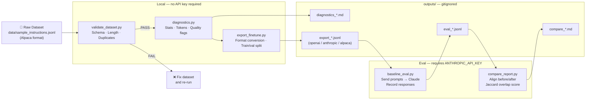
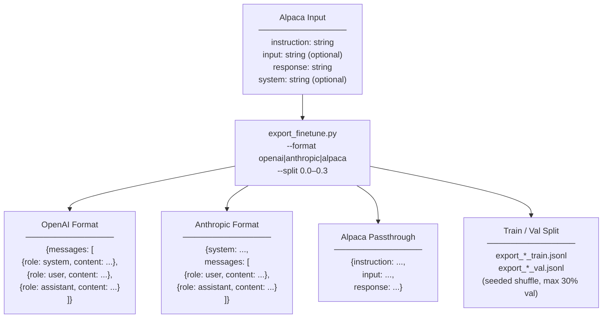
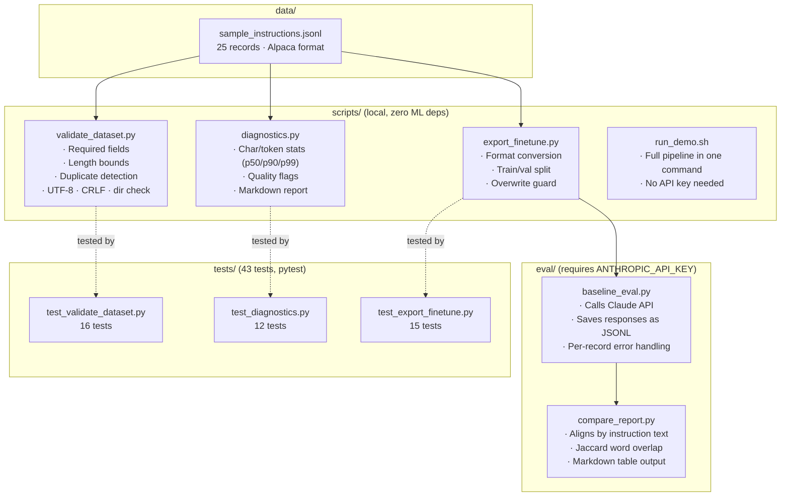
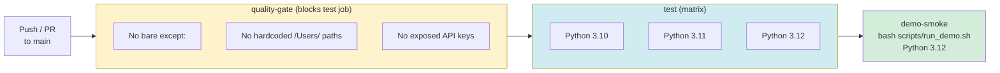
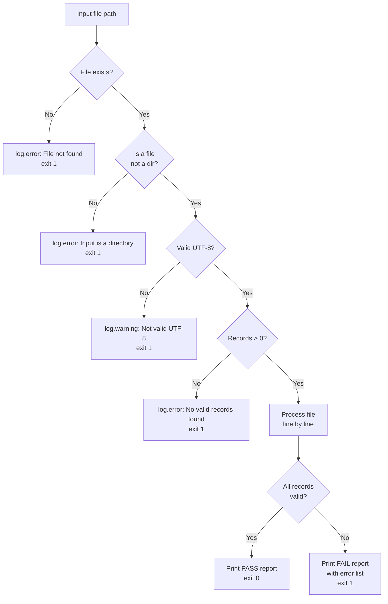

# Architecture & Flow Diagrams

---

## 1. End-to-End Pipeline Flow

---

## 2. Data Format Transformations

---

## 3. Component & Responsibility Map

---

## 4. CI / Quality Gate Pipeline

---

## 5. Error Handling & Exit Codes

